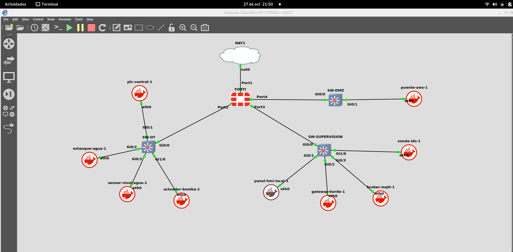

Este repositorio contiene el diseño, configuración y simulación de una arquitectura de red industrial convergente (IT/OT). El proyecto implementa segmentación de red bajo el **Modelo Purdue (ISA-95)** para entornos SCADA, integrando pasarelas de seguridad perimetral (**FortiGate**), conmutación industrial Cisco y microservicios IoT desplegados en contenedores para la supervisión y control de procesos en tiempo real.

---

## 📊 Especificaciones Técnicas del Entorno

| Componente / Capa | Tecnología / Dispositivo | Rol Principal en la Arquitectura |
| :--- | :--- | :--- |
| **Perímetro y Seguridad** | FortiGate (FortiOS) | Enrutamiento inter-VLAN, NAT y políticas de firewall industrial. |
| **Conmutación Industrial** | Cisco IOSv (SW-OT, DMZ, SUP) | Segmentación de capa 2, VLANs (10, 20, 30) y puertos SPAN (IDS). |
| **Automatización / OT** | Contenedores Docker (Python) | Simulación de PLCs, sensores de nivel, actuadores y estanques. |
| **Supervisión y Cloud** | AWS EC2 / MQTT Broker | Telemetría centralizada y almacenamiento en la nube. |

---

## 🗺️ Topología de la Red

---

## 📂 Estructura del Repositorio
* **`configuraciones-e-interfaces/`** - Plantillas CLI depuradas para switches Cisco y el firewall FortiGate.
* **`scripts-docker/`** - Código y scripts de simulación para PLCs, sensores y actuadores industriales.
* **`ec2/`** - Configuración e integración con servicios en la nube (AWS) para telemetría.

---
**Autores:** Martín Ariel Vásquez Márquez & Giovanny Herrera  
**Docente Guía:** Felipe Henríquez  
**Institución:** INACAP — Ingeniería en Telecomunicaciones, Conectividad y Redes (2026)
